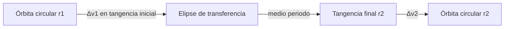

---
tags:
  - fisica/maniobras
aliases:
  - Hohmann
  - Baseline analítico
estado: implementado
fase: 2
codigo: src/orbital_optimizer/orbital/transfers.py
---

# Transferencia de Hohmann

> [!abstract] En una frase
> Transferencia de dos impulsos entre órbitas circulares coplanarias mediante una elipse tangente a ambas (Hohmann, 1925).

## Formulación
Radios inicial $r_1$ y final $r_2$. Elipse de transferencia:

$$a_t = \frac{r_1 + r_2}{2}$$

Aplicando la [[Ecuación de vis-viva]] en cada tangencia:

$$\Delta v_1 = \sqrt{\frac{\mu}{r_1}}\left(\sqrt{\frac{2r_2}{r_1+r_2}} - 1\right), \qquad \Delta v_2 = \sqrt{\frac{\mu}{r_2}}\left(1 - \sqrt{\frac{2r_1}{r_1+r_2}}\right)$$

$$\Delta v_{\text{total}} = |\Delta v_1| + |\Delta v_2|, \qquad t_{\text{transf}} = \pi\sqrt{\frac{a_t^{3}}{\mu}}$$

## Papel en DAEDALUS — el baseline
Es el baseline analítico implementado para órbitas circulares coplanarias. Su uso como referencia exige comparar el mismo problema y restricciones:
- RV-3.01 define una comparación futura; un incumplimiento exige investigar formulación, presupuesto y convergencia antes de diagnosticar un defecto.
- Su Δv y su tiempo son las **escalas de referencia** naturales para adimensionalizar la [[Función objetivo]].

## Requisitos Fase 2
- RF-2.01 a 2.03: Δv de cada impulso, total y tiempo de transferencia.
- RF-2.04: masa de propelente con la [[Ecuación de Tsiolkovsky]].
- RV-2.01: verificar **propagando** la trayectoria con los impulsos aplicados y comprobando la órbita final → implementado con `propagate_with_impulses` (ver [[Maniobra impulsiva]]).
- RV-2.03: con $r_1 = r_2$, $\Delta v \to 0$.

## Límites
Para $r_2/r_1 \gtrsim 11.94$ puede ganarle la [[Transferencia bielíptica]]. No cubre cambio de plano (ver [[Cambio de plano]]).

Relacionado: [[Roadmap por fases]], [[Problema de Lambert]].

## Derivación y correspondencia con la API

Desarrollo algebraico de las ecuaciones de energía: para una circular,
$\epsilon_c=-\mu/(2r)$; para el arco, $\epsilon_t=-\mu/(2a_t)$.
Sustituir en $v^2/2-\mu/r=\epsilon$ da
$v_{c,j}=\sqrt{\mu/r_j}$ y $v_{t,j}=\sqrt{\mu(2/r_j-1/a_t)}$.
Restar velocidades tangenciales antes y después de cada salto produce las
fórmulas anteriores. El arco entre ápsides dura medio periodo de Kepler.

$r_j,a_t$ están en m, $\mu$ en m³/s², velocidades y Δv en m/s, tiempo en s.
Los incrementos con signo son positivos al subir y negativos al bajar;
`HohmannTransfer` devuelve módulos. Invertir radios intercambia primero y
segundo, conservando total y tiempo. Radios iguales dan Δv cero y medio periodo.

**Implemented:** `hohmann_transfer`, validación de radios y μ positivos finitos,
resultado congelado con cinco escalares. **Known Limitations:** no genera
vectores, no impone fase de encuentro, no considera superficie, perturbaciones
ni encendidos finitos. No prueba optimalidad de misiones generales.
**Planned:** alternativas bielípticas, cambio de plano y Lambert.

Fuente teórica consultada el 2026-11-02:
[Orbital Mechanics & Astrodynamics, Hohmann Transfer](https://orbital-mechanics.space/orbital-maneuvers/hohmann-transfer.html).
La evidencia numérica está separada en [[Validación de la Fase 2 e integración]].
