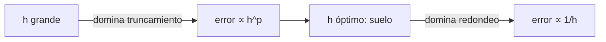

---
tags:
  - algoritmia/numerico
aliases:
  - Error de truncamiento
  - Error de redondeo
  - Error de modelado
estado: teoria
fase: 1
---

# Análisis de error numérico

## Taxonomía
| Tipo | Origen | Comportamiento con el paso $h$ |
|---|---|---|
| Truncamiento local | Cortar la serie de Taylor en cada paso | $\mathcal{O}(h^{p+1})$ |
| Truncamiento global | Acumulación de los locales a lo largo de ~$1/h$ pasos | $\mathcal{O}(h^{p})$ |
| Redondeo | Aritmética float64 finita | Crece al reducir $h$, ~$\mathcal{O}(1/h)$ |
| Modelado | Física omitida (J2, arrastre…) | **Independiente de $h$** |

## El paso óptimo
Truncamiento y redondeo compiten → existe un $h$ óptimo. Por debajo, **reducir el paso empeora el resultado**. En un estudio de convergencia aparece como un **suelo de error**; verlo es en sí una señal de que la implementación es correcta.

## Matices que DAEDALUS hace explícitos
- **Local ≠ global**: las tolerancias de [[Dormand-Prince RK45]] son locales; el error global se mide aparte contra la solución analítica.
- **Muestreado ≠ continuo**: un máximo sobre muestras no es necesariamente el máximo en tiempo continuo.
- **Un caso ≠ una garantía**: una ejecución exitosa prueba solo esa configuración y ese entorno.
- El error de **modelado** no se reduce afinando el integrador: hay que cambiar el modelo ([[Perturbaciones orbitales]]).

Relacionado: [[Orden de convergencia]], [[Tolerancias rtol y atol]], [[Umbral de degeneración numérica]].
