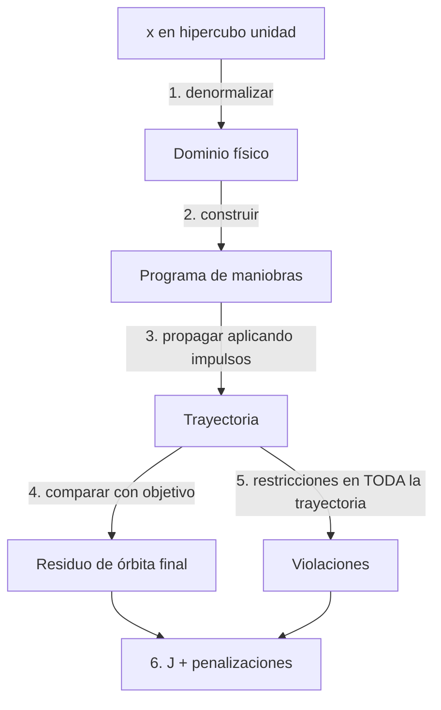

---
tags:
  - algoritmia/optimizacion
aliases:
  - Problema de optimización
  - Método de evaluación
estado: planificado
fase: 3
---

# Formulación del problema de optimización

$$\min_{\mathbf{x}\in\mathcal{X}} \; J(\mathbf{x}) \quad \text{s.a.} \quad g_j(\mathbf{x}) \le 0,\;\; h_k(\mathbf{x}) = 0,\;\; \mathbf{x}_L \le \mathbf{x} \le \mathbf{x}_U$$

> [!important] Formular antes de elegir solver
> RF-3.01 a 3.04 exigen definir **explícitamente** cuatro cosas antes de escribir un optimizador:
> 1. [[Variables de decisión y normalización|Variables de decisión]] — significado, unidades, límites
> 2. [[Función objetivo]]
> 3. Restricciones — igualdades y desigualdades ([[Manejo de restricciones]])
> 4. Método de evaluación — cómo un $\mathbf{x}$ se convierte en un número

## Método de evaluación: la cadena

> [!danger] El paso 5 es el más fácil de hacer mal
> La altitud mínima se comprueba en **toda** la trayectoria: una transferencia puede empezar y terminar en órbitas válidas y atravesar la atmósfera en un periapsis intermedio (RV-4.02).

## Función objetivo cara
Cada evaluación integra una trayectoria completa → el **presupuesto de evaluaciones** es el recurso escaso, no el tiempo de CPU del optimizador. Esto condiciona toda la elección algorítmica y la [[Metodología de benchmark]].

## Requisitos transversales de todo optimizador
- Acepta una **semilla** y es reproducible bit a bit (RF-3.16, RR-01).
- Respeta un **presupuesto máximo de evaluaciones** (RF-3.17).
- Registra la **historia de convergencia** (RF-3.18).
- **Interfaz común**: cualquier algoritmo corre sobre exactamente el mismo problema sin modificarlo (RF-3.10).
- Toda solución devuelta se **re-verifica propagándola** (RV-3.04).

Relacionado: [[Paisaje de optimización orbital]], [[Differential Evolution]].
