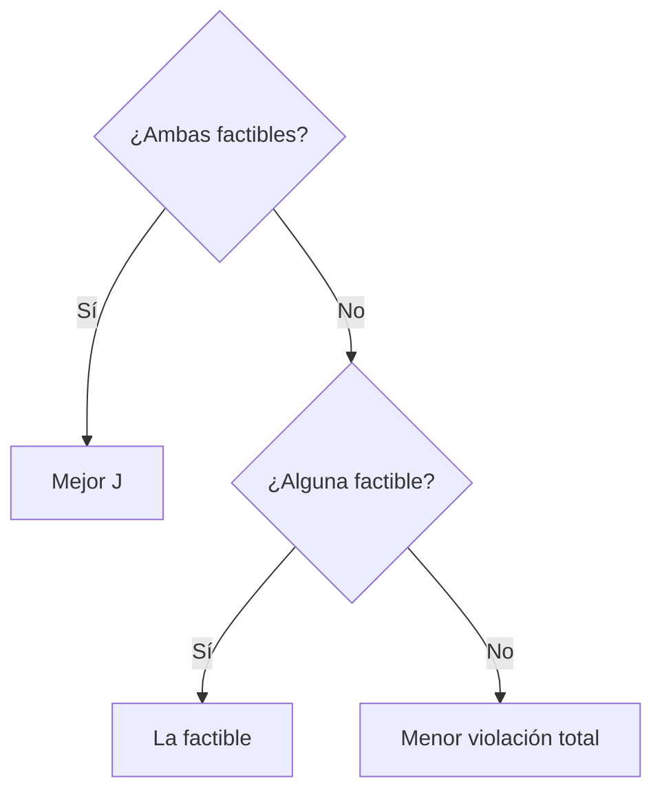

---
tags:
  - algoritmia/optimizacion
  - algoritmia/restricciones
aliases:
  - Deb
  - Feasibility rules
estado: planificado
fase: 4
---

# Reglas de factibilidad de Deb

Deb, 2000. Comparación por torneo **sin ningún coeficiente**. Al comparar dos soluciones:

1. **Ambas factibles** → gana la de mejor objetivo.
2. **Una factible y otra no** → gana la factible.
3. **Ambas infactibles** → gana la de **menor violación total**.

> [!success] Por qué es el punto de partida de DAEDALUS
> - Elimina el coeficiente de penalización $\rho$, que el principio de documentación obligaría a justificar (RF-4.09, RF-3.20).
> - Comportamiento predecible.
> - Encaja de forma natural en la selección voraz de [[Differential Evolution]] y en [[NSGA-II]].

> [!note] Detalle de implementación
> La "violación total" suma violaciones de restricciones con **unidades distintas** → hay que normalizarlas antes de sumar, por el mismo motivo que en la [[Función objetivo]].

Relacionado: [[Manejo de restricciones]].
