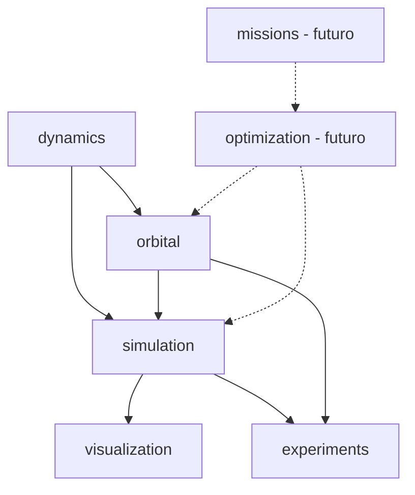

---
tags:
  - proyecto
  - arquitectura
aliases:
  - Arquitectura
---

# Arquitectura del código

Layout `src/` con un espacio de nombres propio (`orbital_optimizer`) para no colisionar con paquetes genéricos como `dynamics`.

```text
src/orbital_optimizer/
  dynamics/two_body.py      EARTH_MU, validate_mu, validate_state, two_body_dynamics
  orbital/mechanics.py      specific_energy, specific_angular_momentum,
                            eccentricity_vector, node_vector, orbital_period,
                            delta_v, total_delta_v, propellant_mass, STANDARD_GRAVITY
  orbital/elements.py       OrbitalElements, elements_to_state, state_to_elements,
                            SINGULAR_TOL
  orbital/kepler.py         solve_kepler (integrado)
  orbital/transfers.py      HohmannTransfer, hohmann_transfer
  simulation/impulsive.py   propagate_with_impulses
  simulation/propagator.py  propagate, PropagationResult, _rk4
  simulation/kepler_propagator.py  propagate_kepler (integrado)
  visualization/plots.py    save_validation_plots (opcional, matplotlib)
src/physics/                adaptadores de compatibilidad (sin duplicar física)
experiments/validate_two_body.py + configs/earth_orbit.json
tests/                      test_dynamics, test_elements, test_propagator, test_experiment,
                            test_kepler, test_transfers, test_impulses (47 tests en total)
```

Reservas vacías para fases futuras: `optimization/` (DE, GA, híbrido, control óptimo), `missions/`, `agent/`.



## Reglas de capas
- La física **nunca** importa simulación ni optimización (dependencias unidireccionales).
- `src/physics/` es un adaptador: una única fuente de verdad para cada ecuación.
- Sin clases de optimizadores o misiones sin uso presente.

## Convenciones de código
- Tipado con `NDArray` / `ArrayLike`; docstrings con unidades.
- Argumentos de configuración solo por nombre (`*`).
- Resultados inmutables: `PropagationResult` es `dataclass(frozen=True)` con arrays de solo lectura; `final_state` devuelve copia.
- `ValueError` para entradas inválidas, `RuntimeError` para fallos de cómputo; el manejo de errores depende de cada función. El salto final impulsivo y las magnitudes de Hohmann no tienen comprobación explícita de finitud de todas sus salidas; ver [[Validación de la Fase 2 e integración]].

Relacionado: [[Convención de unidades]], [[Vector de estado]], [[Principios de ingeniería]].

La ampliación `feature/phase-1-kepler` aún no pertenece a `v0.1.0`.
Su resultado de validación se mantiene en [[Cierre documental de la Fase 1]].
