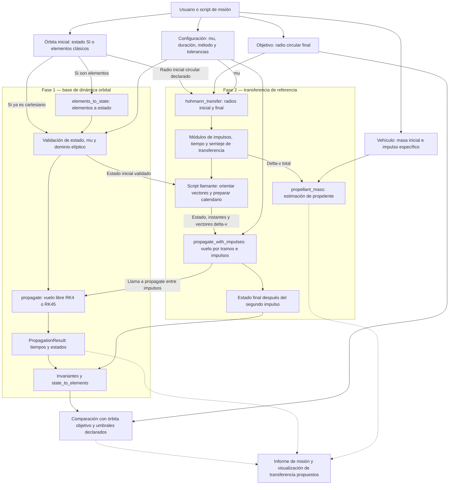
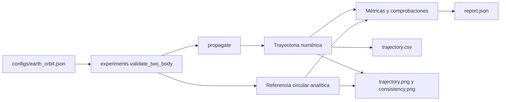

# Data flow: mission planning — fases 1 y 2

**Vista en navegador:** [abrir el diagrama de interacción](mission-planning-interaction.html).
Incluye zoom y funciona sin conexión ni soporte Mermaid.
También está disponible como [imagen SVG](mission-planning-interaction.svg).

Revisión del checkout local: **27 de octubre de 2026**, rama
`feature/phase-2-hohmann`. Este documento describe cómo circulan los datos
desde la definición de una órbita hasta la comprobación de una transferencia.
No implica que exista ya una aplicación de planificación de misiones.

**Leyenda:** flecha continua = intercambio soportado por las interfaces
actuales; flecha discontinua = conexión propuesta que todavía requiere
orquestación o desarrollo. Los bloques de fase 2 corresponden a código local
sin commit en el momento de la revisión; aquí no se certifica su validación.

## Flujo general



El grafo muestra dependencias y datos, no un único programa ya conectado.
La comparación final y la construcción del calendario tienen ejemplos en
`tests/test_impulses.py`; unirlos en un planificador reutilizable sigue siendo
responsabilidad de un script o una capa de misión futura.

## System Architecture / Interaction Diagram

Si tu visor muestra código en lugar del diagrama, abre la
[versión HTML](mission-planning-interaction.html) o la
[versión SVG](mission-planning-interaction.svg).

Esta vista ordena las entidades de izquierda a derecha, empezando por
**Usuario/input**. Cada columna tiene una línea de vida vertical y las
interacciones se leen de arriba abajo. Complementa los flujos de datos
anteriores mostrando quién solicita cada cálculo y quién devuelve el resultado.

Aquí las flechas continuas representan llamadas y las discontinuas representan
respuestas, siguiendo la convención de un diagrama de secuencia. El estado
actual o propuesto se indica en las notas, no en el estilo de las flechas.

```mermaid
sequenceDiagram
    autonumber
    actor U as Usuario / input
    participant S as Script de misión
    participant O as Geometría y mecánica orbital
    participant H as Baseline Hohmann
    participant B as Aplicación de impulsos
    participant P as Propagación RK4 / RK45
    participant D as Dinámica de dos cuerpos
    participant V as Resultados y visualización

    Note over U,V: Fase 1 — definir y estudiar una órbita
    U->>S: Órbita inicial, mu, duración y opciones numéricas
    opt Entrada mediante elementos clásicos
        S->>O: elements_to_state(elementos, mu)
        O-->>S: Estado inicial cartesiano (6,)
    end
    S->>P: propagate(estado, duración, mu, opciones)
    Note over P: Validar entradas y dominio elíptico
    loop Evaluaciones del integrador
        P->>D: two_body_dynamics(t, estado, mu)
        D-->>P: Derivada de posición y velocidad
    end
    P-->>S: PropagationResult: tiempos y estados
    S->>O: Calcular elementos e invariantes de los estados
    O-->>S: Elementos, energía, momento angular y excentricidad
    opt Experimento circular existente
        S->>V: Trayectoria, referencia circular y métricas
        V-->>U: CSV y JSON; PNG al activar plots
    end

    Note over U,V: Fase 2 — calcular y comprobar una transferencia
    Note over S,V: Composición mediante script o tests; no existe un planificador integrado
    U->>S: Radios circulares coplanarios, orientación, masa e Isp
    S->>H: hohmann_transfer(r1, r2, mu)
    H-->>S: Módulos de los dos impulsos y tiempo de transferencia
    S->>S: Orientar el primer impulso tangencial
    S->>B: Propagar con primer impulso hasta la llegada
    B->>B: Sumar delta-v a la velocidad inicial
    B->>P: propagate(estado posterior al impulso, tiempo, mu)
    P->>D: Evaluar dinámica durante el vuelo libre
    D-->>P: Derivadas de los estados
    P-->>B: Estado a la llegada
    B-->>S: Estado previo al segundo impulso
    S->>S: Orientar el segundo impulso con la velocidad de llegada
    S->>B: propagate_with_impulses(estado inicial, dos impulsos, tiempo)
    Note over B,P: Repite el vuelo y aplica el segundo impulso al final, como en el test actual
    B->>P: Propagar los tramos entre impulsos
    P->>D: Evaluar dinámica de vuelo libre
    D-->>P: Derivadas de los estados
    P-->>B: Estado previo al impulso final
    B->>B: Aplicar el segundo delta-v sin cambiar la posición
    B-->>S: Estado final (6,), después del segundo impulso
    S->>O: state_to_elements(estado final, mu)
    O-->>S: Semieje, excentricidad, inclinación y demás elementos
    S->>S: Comparar órbita final con objetivo y tolerancias
    S->>O: propellant_mass(masa inicial, delta-v total, Isp)
    O-->>S: Propelente ideal consumido en kg
    S-->>U: Coste, tiempo, consumo y resultado de las comprobaciones
    opt Conexión futura de presentación de misión
        Note over S,V: Requiere guardar tramos y desarrollar un informe o visor de transferencia
        S->>V: Trayectoria por tramos, maniobras y métricas
        V-->>U: Informe y visualización de la transferencia propuestos
    end
```

**Script de misión** representa el código que llama a las funciones, no un
módulo de planificación ya implementado. En fase 1 esa función la cumple
el experimento circular; en fase 2 los tests muestran cómo conectar el
baseline y los impulsos. La doble propagación ilustrada reproduce el patrón
actual de `tests/test_impulses.py` para obtener la dirección del segundo
impulso y después comprobar el calendario completo.

**Dinámica de dos cuerpos** calcula derivadas; el propagador decide los
pasos temporales. **Resultados y visualización** consume estados ya
calculados: la exportación circular existe, mientras que la presentación
integrada de una transferencia está indicada como conexión futura.

## Fase 1: de una órbita a resultados observables

El usuario proporciona un estado `y0=[x,y,z,vx,vy,vz]` o un
`OrbitalElements`. `elements_to_state` convierte la segunda representación.
`propagate` valida las entradas y evoluciona el estado con la gravedad de
dos cuerpos, sin aplicar maniobras.

El resultado contiene `times (N,)`, `states (N,6)`, método, μ y evaluaciones
de la derivada. A partir de sus estados se calculan energía, momento angular,
excentricidad y elementos orbitales para interpretar la trayectoria.

La cadena de exportación que ya existe es específica del experimento circular:



Los PNG se generan al usar `--plots`. Esta referencia circular y sus gráficos
no constituyen un validador o un visor genérico de transferencias de Hohmann.

## Fase 2: de la intención de transferencia a la órbita final

1. **Definir la misión.** Indicar radios circulares `r1`, `r2`, μ y una
   orientación inicial. Las órbitas deben estar en el mismo plano y alrededor
   del mismo cuerpo. El radio se mide desde el centro, no desde la superficie.
2. **Calcular el baseline.** `hohmann_transfer(r1,r2,mu)` devuelve los módulos
   de ambos impulsos, su suma, el tiempo de transferencia y el semieje de
   la elipse. No devuelve direcciones ni una trayectoria.
3. **Construir las maniobras.** El script llamante convierte los módulos en
   vectores tangenciales en el marco inercial y prepara
   `[(0, dv1_vector), (transfer_time, dv2_vector)]`. En una subida ambos
   impulsos aceleran en el sentido local del movimiento; en una bajada frenan.
   El vector del segundo impulso usa la dirección local a la llegada, no
   necesariamente la del primero. Los módulos no determinan por sí solos
   los signos de los vectores.
4. **Aplicar y propagar.** `propagate_with_impulses` suma cada vector a la
   velocidad, conserva la posición en el instante del impulso y usa
   `propagate` entre maniobras. Devuelve únicamente el estado final `(6,)`,
   incluyendo el impulso situado en el instante final.
5. **Comprobar el resultado.** Un script o test obtiene elementos e
   invariantes del estado final y compara radio, velocidad, semieje,
   excentricidad y plano con el objetivo, usando tolerancias explícitas.
   La aceptación depende de estas comprobaciones; ejecutar el propagador
   sin excepción no prueba que se haya alcanzado la misión.
6. **Estimar el consumo.** `propellant_mass(m0,total_delta_v,Isp)` calcula
   el propelente ideal con Isp constante. Es un cálculo separado; no introduce
   masa variable, empuje ni duración finita en la propagación.

El caso `r1=r2` produce coste Δv cero en el baseline; si se quiere una misión
de permanencia sin maniobras, el llamante debe tratarla explícitamente.
No se afirma que exista un selector automático de estrategia de misión.

## Contratos de datos entre bloques

| Datos | Contenido y unidades | Productor → consumidor |
| --- | --- | --- |
| Estado inicial | Vector `(6,)`: posición en m y velocidad en m/s | Usuario o `elements_to_state` → propagadores |
| Configuración física | μ positivo, m³/s²; marco inercial común | Usuario → conversiones, mecánica y propagadores |
| Configuración numérica | Duración, muestras y paso en s; tolerancias de posición/velocidad | Script → `propagate`; la versión con impulsos no recibe `sample_times` |
| Resultado de vuelo libre | `PropagationResult`, con estados muestreados y tiempos | `propagate` → análisis, CSV y gráficos |
| Objetivo Hohmann | Radios inicial y final positivos, en m | Usuario → `hohmann_transfer` y comprobación final |
| Baseline | `HohmannTransfer`: módulos Δv en m/s, tiempo en s, semieje en m | `hohmann_transfer` → script llamante y consumo |
| Calendario de impulsos | Secuencia de `(tiempo_s, vector_delta_v (3,))`; tiempos crecientes | Script llamante → `propagate_with_impulses` |
| Estado de llegada | Vector `(6,)` posterior a los impulsos | `propagate_with_impulses` → elementos y comprobación objetivo |
| Vehículo ideal | Masa inicial en kg, Isp en s | Usuario → `propellant_mass` |
| Consumo ideal | Masa consumida en kg | `propellant_mass` → informe del llamante |

## Archivos e interfaces que sustentan el flujo

| Responsabilidad | Implementación |
| --- | --- |
| Gravedad y validación básica | [two_body.py](../src/orbital_optimizer/dynamics/two_body.py) |
| Conversión de representaciones | [elements.py](../src/orbital_optimizer/orbital/elements.py) |
| Invariantes, costes y propelente | [mechanics.py](../src/orbital_optimizer/orbital/mechanics.py) |
| Vuelo libre y resultado muestreado | [propagator.py](../src/orbital_optimizer/simulation/propagator.py) |
| Baseline Hohmann | [transfers.py](../src/orbital_optimizer/orbital/transfers.py) |
| Aplicación de impulsos | [impulsive.py](../src/orbital_optimizer/simulation/impulsive.py) |
| Ejemplo de conexión entre Hohmann y propagación | [test_impulses.py](../tests/test_impulses.py) |
| Referencias de transferencia y consumo | [test_transfers.py](../tests/test_transfers.py) |
| Exportación del experimento circular | [validate_two_body.py](../experiments/validate_two_body.py) |
| Gráficos del experimento circular | [plots.py](../src/orbital_optimizer/visualization/plots.py) |

## Límites y conexiones pendientes

La API de Hohmann actual devuelve magnitudes, no una misión completa.
El propagador con impulsos no devuelve una historia de estados; visualizar
la transferencia requiere recoger los tramos y representar los saltos de
velocidad sin confundir el estado anterior y posterior a cada impulso.
No existe en este checkout una exportación de misión equivalente al CLI
del experimento circular. Esas conexiones aparecen discontinuas en el diagrama.

Este flujo cubre órbitas circulares coplanarias y el modelo ideal de dos
cuerpos. No incorpora rendezvous con un satélite en una fase orbital concreta,
cambios de plano, Lambert, perturbaciones, encendidos finitos ni optimización.
La inspección del código acredita las interfaces descritas; no sustituye
una ejecución de las pruebas de fase 2.

Documentos relacionados: [contrato de fase 1](phase1.md),
[API de fase 2](phase2-api.md) y
[requisitos de ambas fases](02-requerimientos.md).
